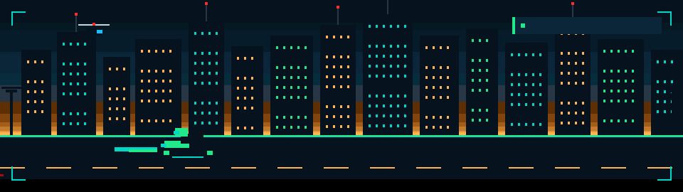
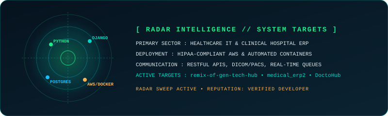

# CSVS UNDERWORLD — ULTIMATE DEVELOPER EDITION

<div align="center">

<!-- Actual Frame-Animated Hero Banner (Moving Supercar, Moving Superbike & Los Santos Night Skyline) -->


[](https://github.com/MartinLourduraj)
[](https://csvsittech.in)
[](mailto:contact@csvsittech.in)
[](https://github.com/MartinLourduraj)

</div>

---

```ascii
  +========================================================================================+
  |  >>> [!] CSVS UNDERWORLD // SYSTEM ONLINE -- SECURE TERMINAL ESTABLISHED <<<          |
  |                                                                                        |
  |  USER           : MARTIN LOURDURAJ (@MartinLourduraj)                                 |
  |  ORGANIZATION   : CSVS IT TECH                                                        |
  |  ROLE           : FULL-STACK ENGINEER & HEALTHCARE IT ARCHITECT                       |
  |  LOCATION       : INDIA (GLOBAL CLOUD & LOS SANTOS SECTOR)                            |
  |  SPECIALIZATION : CLINICAL ERP, HOSPITAL AUTOMATION, SECURE DEVOPS                    |
  |  SIGNATURE      : BUILD SYSTEMS. OWN THE NIGHT.                                       |
  +========================================================================================+
```

---

## 🌴 SECTION A — PLAYER IDENTITY

> **"Building secure, scalable, and user-friendly healthcare systems with modern technologies."**

I am **Martin Lourduraj**, Founder, Developer, and Tech Lead at **CSVS IT Tech**. I specialize in full-stack healthcare platforms, clinical ERP architectures, laboratory integration, and automated cloud deployments with zero compromise on data security and regulatory compliance.

Whether orchestrating clinical workflows for hospitals or automating multi-stage CI/CD pipelines on the cloud, my objective is clear: **build mission-critical systems that never fail under pressure.**

---

## 🎯 SECTION B — MISSION CONTROL & DEVELOPER RADAR

<div align="center">



</div>

### Key Operational Doctrines

- 🏥 **Hospital Management Systems (HMS):** End-to-end clinical workflow, in-patient, out-patient, bed management & automated billing.
- 🔬 **Lab & Radiology Integration:** PACS/DICOM compliant diagnostic reports, automated test result dispatch and lab device interfaces.
- ☁️ **Cloud Deployment & Automation:** Secure HIPAA-ready AWS cloud infrastructure, containerized microservices and automated CI/CD pipelines.
- 🛡️ **Data Security & Compliance:** Role-based access control, encrypted patient records, audit trails and zero-downtime database replication.

---

## 🏎️ SECTION C — REPOSITORY GARAGE (ACTIVE MISSIONS)

All displayed missions represent verified public repositories engineered by Martin Lourduraj:

| Mission / Repository | Focus & Architecture | Primary Stack | Access |
| :--- | :--- | :--- | :---: |
| [**`remix-of-gen-tech-hub`**](https://github.com/MartinLourduraj/remix-of-gen-tech-hub) | Next-gen healthcare & hospital management system | `TypeScript` `React` `Remix` | `Public` |
| [**`medical_erp2`**](https://github.com/MartinLourduraj/medical_erp2) | Hospital ERP with OP, IP, Lab, Radiology, and Clinical Reporting | `Python` `Django` `PostgreSQL` | `Public` |
| [**`DoctoHub`**](https://github.com/MartinLourduraj/DoctoHub) | Doctors combination social media and patient healthcare platform | `Django` `Python` `AWS` | `Public` |

---

## 🛠️ SECTION D — TECHNOLOGY ARSENAL

Verified technologies deployed across CSVS IT Tech production stacks:

<div align="center">

| Domain | Verified Weapons & Toolchains |
| :--- | :--- |
| **Backend & Core** |   |
| **Frontend & Web** |    |
| **Databases** |  |
| **Cloud & Systems** |   |
| **DevOps & Automation** |    |

</div>

---

## 📊 SECTION E — CONTRIBUTION INTELLIGENCE

Real-time telemetry and verified language distribution:

<div align="center">


</div>

---

## 🌐 SECTION F — BRAND IDENTITY & SECURE COMMS

- 🏢 **Enterprise & Brand:** [CSVS IT Tech](https://csvsittech.in)
- 💼 **LinkedIn Network:** [Connect on LinkedIn](https://www.linkedin.com)
- ✉️ **Direct Email:** [contact@csvsittech.in](mailto:contact@csvsittech.in)
- 📍 **GitHub Profile:** [https://github.com/MartinLourduraj](https://github.com/MartinLourduraj)

---

<div align="center">


### 🏆 MISSION STATUS: COMPLETE // RESPECT +

```
[ GTA SAN ANDREAS + GTA V + GTA VI HYBRID DEVELOPER SUITE ]
Engineered by Martin Lourduraj • CSVS IT Tech
```

</div>
